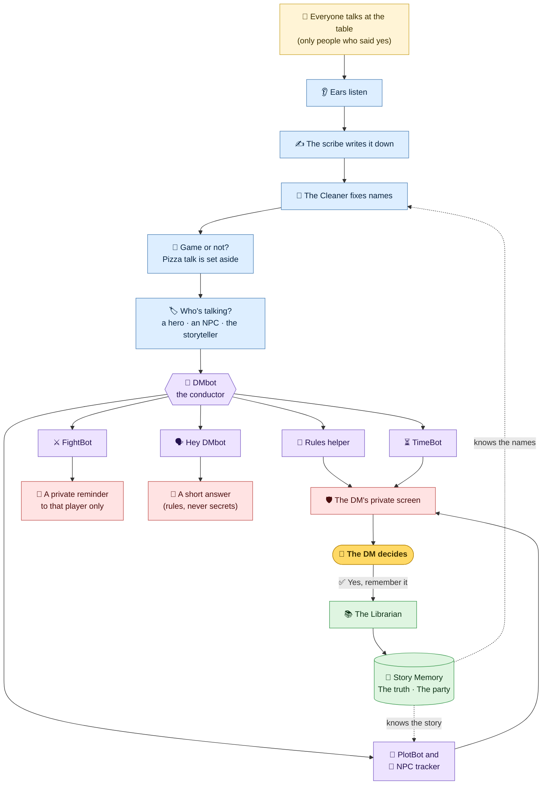
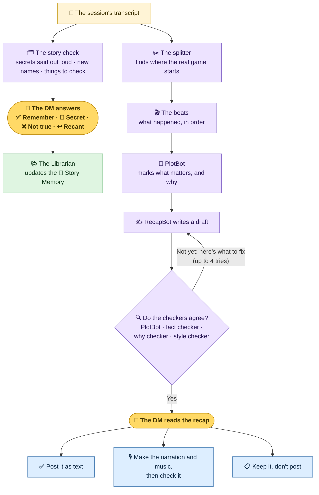

# How DMbot works

*A plain-words tour of DMbot's helpers and how they work together. Part 1 is written so it can go on
the website as it is. Part 2 is for people building DMbot.*

---

## Part 1: For everyone

### The big idea

DMbot is a quiet helper for the **Dungeon Master (DM)**. It listens to your game, remembers your story,
and whispers tips to the DM. It has one golden rule:

> **DMbot helps. The DM decides.**
> DMbot never makes up story and never makes a ruling. It only suggests, points to where a rule comes
> from, and remembers what happened.

DMbot is not one big brain. It is a **team of small helpers**, and each one has one job. DMbot itself
is the **conductor**: it hands each piece of the game to the helper that needs it, and it makes sure
every helper follows the rules below.

### Four rules every helper follows

| | Rule | What it means |
|---|---|---|
| 🙋 | **Only people who said yes** | DMbot only listens to people who pressed "yes". Bots are never recorded. Anyone can press **Stop recording me**, or say "Hey DMbot, off the record", at any time. |
| 👑 | **The DM decides** | Helpers suggest. Nothing goes into the story until the DM says yes. |
| 🤫 | **Secrets stay with the DM** | Tips, secret names and plot notes go only to the DM's private screen. Players never get a secret from DMbot. |
| 🏰 | **Every campaign is its own world** | One campaign's story never leaks into another campaign, or into another Discord server. |

### Meet the team

**While you play**

| Helper | Its job, in one line |
|---|---|
| 👂 **Ears** | Listens in the game's voice channel, only to people who said yes. |
| ✍️ **The scribe** | Writes down what each player and the DM says. That is the **transcript**. |
| 🧹 **The Cleaner** | Fixes names the scribe heard wrong ("Tavern" → "Tavin"). |
| 🚦 **The game-or-not check** | Sets aside talk that isn't the game ("who wants pizza?"). |
| 🏷️ **The who's-talking tag** | Marks each line: a hero, an NPC the DM is voicing, or the DM telling the story. |
| 📏 **The rules helper** | Spots a rule moment and gives the DM a short tip, with where the rule comes from and how sure it is. |
| ⏳ **TimeBot** | Keeps the game clock: rests, travel, spells running out, dawn and dusk. |
| ⚔️ **FightBot** | In a fight, sends each player a private reminder of their own character's tricks ("You still have 2 spell slots"). |
| 🗣️ **"Hey DMbot"** | Answers quick questions. The DM gets a private answer. A player's rules question is answered in the campaign's chat. Anything that needs the DM gets "That's one for your DM." |
| 🖼️ **The picture reader** | Describes a picture someone posts in the game's chat, so the transcript can say what it showed. *(Built, and off until it is switched on.)* |

**The story keepers**

| Helper | Its job, in one line |
|---|---|
| 📚 **The Librarian** (EntityBot) | The **only** helper allowed to write in the Story Memory. Others bring it ideas. It writes a fact down only when the DM says yes. |
| 🧠 **The Story Memory** | Everything the campaign remembers: people, places, things, and how they connect. On the website it is the **Story graph**. It keeps two views: **The truth** (what the DM knows) and **The party** (what the players know). |
| 👥 **The NPC tracker** | Remembers the people you meet, who they work for, and who they love or hate. |
| 🧭 **PlotBot** | The story's best friend. Keeps track of plot threads, promises and clues, notices when something doesn't fit, and checks every recap. |
| 🗺️ **MapBot** | Will draw simple maps from facts the DM has confirmed. *(Coming later.)* |

**After the game**

| Helper | Its job, in one line |
|---|---|
| 🗂️ **The story check** | Tells the DM what to look at: secrets someone said out loud (with **↩️ Recant**), new names, and things to check. |
| ✂️ **The splitter** | Finds where table talk, catch-up and "last time…" end and the real game begins. |
| ✍️ **RecapBot** (the Writer) | Writes the story of the session, using only what really happened. |
| 🔍 **The checkers** | Read each draft. PlotBot checks the story, the **fact checker** checks every line really happened, the **why checker** checks no one's reasons were made up, and the **style checker** checks it reads well. |
| 🎙️ **The narrator** | Reads the recap aloud with music, if the DM wants it. |

### How it all flows: during the game

Follow the arrows from the top. Purple boxes are the helpers that think about the game. The gold
crown is always the end of the line: **the DM decides**.

### How it all flows: after the game

When the game ends, DMbot writes the recap and tidies the Story Memory. Nothing is shared until the DM
says so.

### Who gets to see what

| | The DM | Players |
|---|---|---|
| The transcript | ✅ | ✅ Everyone in the server can read it. Only people who said yes are in it. |
| Tips, secret names, plot notes (the DM screen) | ✅ | 🚫 Only if the DM lets them peek. |
| FightBot's reminder | — | ✅ Only the player it's about. |
| An answer to a rules question | ✅ | ✅ In the campaign's chat. Never a secret, never a ruling. |
| The recap | ✅ First | ✅ Only after the DM posts it. |
| The Story Memory | ✅ **The truth** | ✅ **The party** (what the players already know). |

### Different helpers, different-sized brains

Some jobs are easy and some are hard, so DMbot uses different-sized AI brains:

- ⚡ **The quick brain** for small, fast jobs: fixing names, game-or-not, quick rules tips, the first "Hey DMbot" answer, FightBot.
- 🧐 **The careful brain** for jobs that need more thought: finding new names, house rules, reading character sheets.
- 🔭 **The deep brain** for the hardest thinking: PlotBot.
- 🖋️ **The storyteller brain** for writing the recap.

Small jobs use the small brain, so DMbot stays quick at the table and doesn't cost more than it needs to.

### Still have a question?

Send it to us on the **Say hello** page. It has a short form, and we read every message. You can also
read and ask in the public **Questions and answers**, where anyone can see the answers (so don't put
private details there).

---

## Part 2: For builders

*Not for the website. This part names the code, so a developer can find each helper.*

### Where each helper lives

| Helper | Where | Notes |
|---|---|---|
| Ears | `ears/` (Node + TypeScript) | The only part that touches voice (DAVE E2EE). It captures each consenting, non-bot speaker and streams PCM to core. No game logic. The protocol is in `ears/src/protocol.ts` and `core/src/dmbot/ears/protocol.py`. |
| Scribe | `core/` speech-to-text pipeline | Cloud speech-to-text by default. Consent is re-checked after every async step. |
| Cleaner | `core/src/dmbot/transcript/` | Reads campaign memory and never writes it. The AI only ranks "Did they mean…?" options; it never fixes a line (step 6). |
| Game-or-not check | off-topic filter | FAST tier. Hides from the cleaned transcript only, never the raw one. |
| Who's-talking tag | speaker tagging | Labels a line `{narrating}`, an NPC, `{table_talk}` or a character. |
| Rules helper | rules index (SRD 5.2.1 and the glossary), house rules | The precedence is house rules → homebrew → target ruleset → fallback. Every alert carries its source and confidence. |
| TimeBot | `dmbot.timebot` | Game time, not real time. |
| FightBot | one per player character, only in combat | FAST tier, at most one message per player per 2 minutes. It reads that player's sheet plus what the table already knows. |
| "Hey DMbot" | DM sidebar and table questions | The DM gets a private answer, logged `[DM Sidebar]` in the raw transcript only. Table questions are answered in `dmb-chat` and logged `[Table Q]`. |
| Picture reader | `dmbot.images`, `image_desk`, `map_notes` | Off unless `DMBOT_TABLE_IMAGES` is on, and reads only consent at terms version 7 or later (the go-live PR raises the version). Map notes are kept only with the Shared-story right-to-use confirmation. |
| Librarian (EntityBot) | `dmbot.memory` | The **only** writer of campaign memory. Split into small roles (extractor, continuity checker, ontology steward, graph curator, summarizer) behind deterministic checks. Other helpers send it proposals, and the DM's confirmation makes a fact confirmed. |
| Story Memory | Postgres property graph, row-level security per server and campaign | Beliefs live in two layers: The truth and The party. "Revealed" is a party belief, not a flag. Importance (#2411) comes from connections, hidden ones included, and is used for ranking only. See `docs/STORY_MEMORY.md`. |
| NPC tracker / PlotBot | phase 5 | They read **confirmed** memory only. PlotBot is DM-only, so it may read DM-only connections; the recap writer never gets them. DEEP tier, run in batches. |
| MapBot | not built | It will draw from asserted facts only, never from the AI's map readings. |
| Story check | knowledge map review (#2410) | Exposures are recorded, then the after-session summary applies them with ↩️ Recant. Nothing is revealed before the DM is told. |
| Recap team | `dmbot.recaps` | Split → beats → PlotBot's significance notes → writer (creative tier) → critic loop (PlotBot, grounding, motive, style; at most 4 rounds) → the DM approves (text, audio, or keep). The day's spend is capped (#2308). |
| Narrator | recap audio | Narration and music are made only when the DM chooses audio, inside the plan's monthly allowance. |

### How the AI is chosen

Every AI call names a **tier**, never a model (`dmbot.ai.FEATURE_TIERS`; a test checks that no other file names a model):

- FAST: transcript cleaning, the off-topic filter, rules checks and lookups, the audio check, the sidebar's first answer, FightBot.
- CAREFUL: Find names, house-rule changes, character sheets, the sidebar's second try.
- DEEP: PlotBot.
- The recap writer uses the creative model (`AI_MODEL_CREATIVE`), and a small model formats its text.

### Rules that keep the team safe

1. **Consent first.** Ears has an allowlist, and core re-checks consent after every async step.
2. **One writer.** Only EntityBot writes memory, and the DM's yes makes a fact confirmed.
3. **Secrets flow one way.** DM-screen content never reaches a transcript, a player or a public channel. The recap writer sees only what the players know.
4. **Isolation.** Every query, cache, file and AI prompt is scoped to one campaign. The only exception is shared rulesets, and those carry rules only.
5. **Cite, don't assert.** Every alert names its source and how confident DMbot is.

See `docs/PLAN.md` for each decision, its date and its reason.
